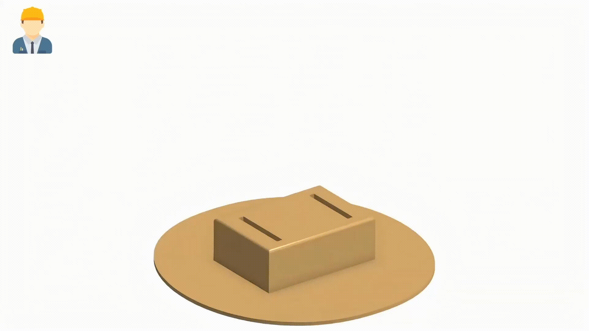
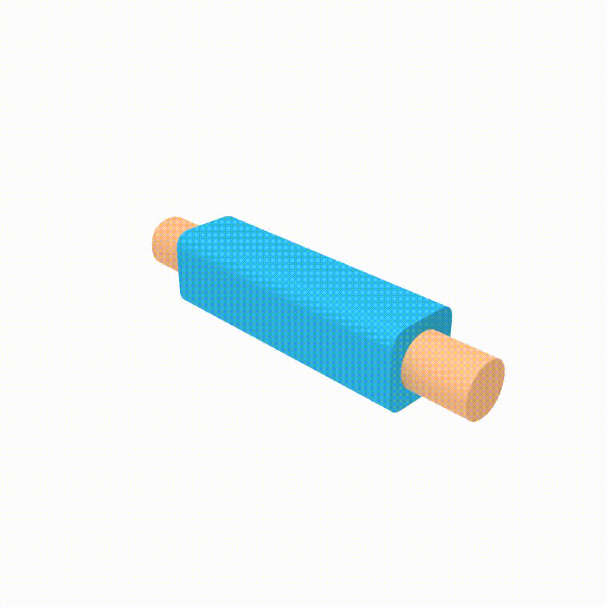

# CADKnitter: Compositional CAD Generation from Text and Geometry Guidance

*SIGGRAPH Asia 2026 Conference Proceedings*

[](https://cadknitter.github.io/)
[](https://arxiv.org/abs/2512.11199)
[](https://huggingface.co/datasets/Fsoft-AIC/knitcad)
[](https://huggingface.co/Fsoft-AIC/cadknitter)


<p align="center"><em>A practical application of CADKnitter: generating a complementary part that fits an existing CAD design.</em></p>

## Installation

### Dependencies

**1 — Create the environment** (CUDA 12.1 PyTorch and the rest; use `mamba` if conda hangs on "Solving environment"):
```
conda env create -f environment.yml
conda activate cadknitter_env
```

**2 — Install the vendored packages** in `third_party/`. They compile against the installed PyTorch, so build isolation must be off:
```
pip install -e ./third_party/occwl-main
pip install --no-build-isolation -e ./third_party/pytorch3d-main
pip install --no-build-isolation -e ./third_party/chamferdist-master
```

If `chamferdist` fails to build, set `CUDA_HOME` to a CUDA 12.1 installation, or [build it from source](https://github.com/krrish94/chamferdist?tab=readme-ov-file#building-from-source).

## Dataset

The full KnitCAD dataset (~115 GB) is hosted on Hugging Face at
[`Fsoft-AIC/knitcad`](https://huggingface.co/datasets/Fsoft-AIC/knitcad). It is uploaded as a
single `tar.gz` archive split into four parts (`knitcad.tar.gz.aa` … `knitcad.tar.gz.ad`),
so the parts must be concatenated before extraction. The data split files are hosted there as well.

The repo ships with only one sample joint set in `data/pkl/` for a quick smoke test.
Download the full dataset to train or evaluate.

**1 — Download the archive parts** (needs ~115 GB free, plus room for the extracted data):

```
huggingface-cli download Fsoft-AIC/knitcad --repo-type dataset \
    --include "knitcad.tar.gz.*" "knitcad_data_split*.json" --local-dir ./knitcad_download
```

**2 — Merge the parts and extract:**

```
cat ./knitcad_download/knitcad.tar.gz.a? > ./knitcad_download/knitcad.tar.gz
tar -xzf ./knitcad_download/knitcad.tar.gz -C ./knitcad_download
```

**3 — Replace `data/pkl` with the extracted folder and move the split files into `data/`:**

```
rm -rf data/pkl
mv ./knitcad_download/knitcad data/pkl
mv ./knitcad_download/knitcad_data_split*.json data/
```

Once the parts are merged and extracted successfully, the archive parts and the merged
`knitcad.tar.gz` can be deleted to reclaim disk space.

## Pretrained checkpoints

**1 — BrepGen checkpoints.** Download the ABC pretrained weights from the original repo,
[BrepGen — Pretrained Checkpoint](https://github.com/samxuxiang/BrepGen#pretrained-checkpoint),
and place these files in `./weights/`.

**2 — CADKnitter checkpoint.** The fine-tuned surface-position network is on Hugging Face at
[`Fsoft-AIC/cadknitter`](https://huggingface.co/Fsoft-AIC/cadknitter):

```
huggingface-cli download Fsoft-AIC/cadknitter knitcad_ldm_surfpos.pt --local-dir ./weights
```

The resulting layout must match the paths in `eval_config.yaml`:

```
weights/
├── knitcad_ldm_surfpos.pt   # CADKnitter (surface position)
├── abc_ldm_surfpos.pt       # only needed to fine-tune (runs/train_ldm.sh)
├── abc_ldm_surfz.pt
├── abc_ldm_edgepos.pt
├── abc_ldm_edgez.pt
├── abc_vae_surf.pt
└── abc_vae_edge.pt
```

## Training 
Train the latent diffusion model (change path to previously trained VAEs):

```
sh runs/train_ldm.sh
```

## Generation
```
sh runs/sample.sh
```

This will load the settings in ```eval_config.yaml```.

## Evaluation
Create the ground-truth CAD pairs, then compute the metrics on the generated samples (results are saved to `eval/eval_results/`):

```
sh runs/create_eval_gt.sh
sh runs/eval.sh
```

## Visualization
To render turntable videos of CAD pairs, see [README_vis.md](README_vis.md).

<p align="center"></p>

## Acknowledgement
Our codebase builds on [BrepGen](https://github.com/samxuxiang/BrepGen) — many thanks to the authors for sharing their code, instructions, and pretrained weights.

## Citation
If you use this repository, please cite CADKnitter and BrepGen, on which it builds:

```bibtex
@inproceedings{le2026cadknitter,
  author    = {Le, Tri and Nguyen, Khang and Huang, Baoru and Ta, Tung D and Nguyen, Anh},
  title     = {CADKnitter: Compositional CAD Generation from Text and Geometry Guidance},
  booktitle = {SIGGRAPH Asia 2026 Conference Papers},
  year      = {2026},
}

@article{xu2024brepgen,
  title={BrepGen: A B-rep Generative Diffusion Model with Structured Latent Geometry},
  author={Xu, Xiang and Lambourne, Joseph G and Jayaraman, Pradeep Kumar and Wang, Zhengqing and Willis, Karl DD and Furukawa, Yasutaka},
  journal={ACM Transactions on Graphics},
  volume={43},
  number={4},
  pages={1--14},
  year={2024},
  doi={10.1145/3658129}
}
```
